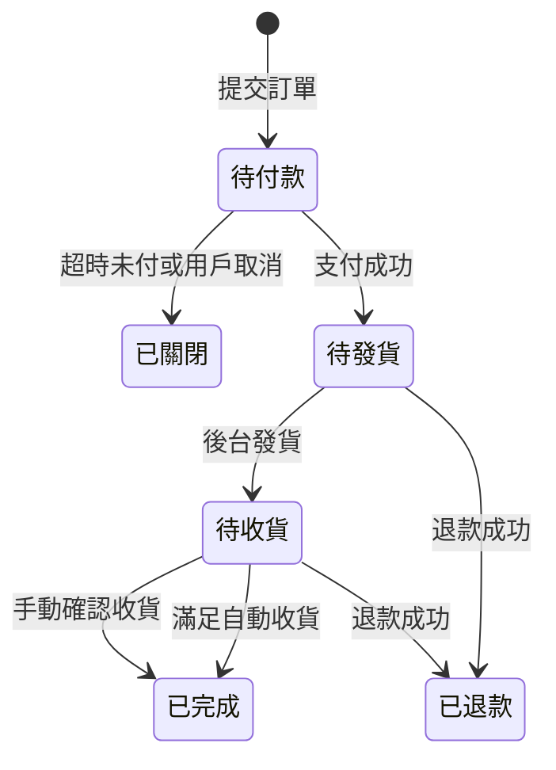

# SisterMart H5 商城產品需求文檔（PRD）

| 項目 | 內容 |
| --- | --- |
| 產品 | SisterMart 移動商城 |
| 版本 | 1.4 |
| 日期 | 2026-10-13 |
| 形態 | H5 單頁應用（SPA） |
| 前端 | Vue 3 |
| 接口 | ThinkPHP |
| 管理後台 | ThinkPHP + Vue 3（Naive UI） |
| 市場 | 香港 |
| 貨幣 | HKD |
| 語言 | 繁體中文（香港）、英文 |

體驗流程在登錄、忘記密碼、商城首頁、商品詳情上對齊 Bagisto 的移動端路徑。頁面文案、模塊和交易規則以本文為準。

1.1 補充：商品圖全屏縮放、底部收藏與分享、秒殺只能立即購買並展示圖文詳情、下級列表的消費與佣金、訂單消息與系統消息。

1.2 調整：主框架改為頂欄店名加搜索、底部四個功能鍵。商品卡左上角標籤、右上角收藏，價格右側按後台設置顯示已售數量。

1.3 調整：底部四鍵改為圖標在上、文字在下。圖標、圖標背景、文字、文字顏色和底欄背景在每次進入頁面時向接口讀取，不寫死在前端。

1.4 調整：頂欄搜索框右側增加收藏夾和消息。分類頁改為左側大類列表、右側該大類的子類圖格。

## 1. 目標

做一個面向香港用戶的 H5 珠寶商城。用戶用瀏覽器完成瀏覽、註冊登錄、下單支付、查物流、售後和分銷。運營在後台維護商品、首頁、訂單、營銷、積分、佣金和協議文章。

## 2. 本期範圍

### 2.1 要做

- 賬號：郵箱或手機註冊、郵箱密碼登錄、手機 WhatsApp 驗證碼登錄、忘記密碼、協議勾選
- 首頁、分類、搜索、商品詳情（多規格 SKU）
- 購物車、確認訂單、支付、訂單、物流、售後、評價
- 秒殺、優惠券、積分（含積分商城）、每日簽到
- 一級分銷、佣金、提現到餘額或轉數快
- 資訊與協議文章
- 個人中心及上表對應的後台配置

### 2.2 本期不做

- 遊客結帳
- 以圖搜圖（首頁搜索框不放相機）
- 信用卡分期 / EMI
- 定金預售、尾款
- 餘額充值
- 服務標籤中的「7 天無理由」固定文案
- 快遞公司軌跡 API（物流節點由後台錄入）
- 二級及以上分銷

## 3. 已確認規則

| 主題 | 規則 |
| --- | --- |
| 下單 | 必須登錄 |
| 支付 | 轉數快 FPS、AlipayHK、微信支付香港 |
| 商品 | 多規格 SKU，各規格獨立售價、劃線價、庫存 |
| 註冊驗證 | 郵箱或手機二選一，都要驗證碼 |
| 手機驗證碼 | 發到 WhatsApp。發送失敗時改發到該用戶郵箱；沒有郵箱則先補郵箱再發 |
| 地址 | 只收香港地址 |
| 運費 | 未滿門檻收固定運費，滿門檻包郵。門檻與運費由後台配置，上線前由運營填寫 |
| 分銷資格 | 註冊會員即有獨立推廣 ID |
| 分銷層級 | 只記直接推薦人 |
| 佣金 | 按商品配置。方式一：扣除全部優惠後的該商品實付金額 × 百分比。方式二：固定金額（例如 HKD 10） |
| 佣金入帳 | 訂單變為「已完成」時入帳 |
| 提現 | 可轉入商城餘額，或申請提到轉數快（後台審核打款）。最低提現額後台配置，示例 HKD 100 |
| 餘額 | 不做充值。餘額來自佣金轉入，以及售後退款時選擇退回餘額 |
| 訂單完成 | 買家手動確認收貨，或滿足自動收貨條件。自動收貨天數 N 由後台配置 |
| 自動收貨 | 從支付成功起算滿 N 天，且訂單已發貨，且買家沒有點過「發起售後」或「退款」 |
| 未發貨 | 滿 N 天仍未發貨時不自動完成。發貨之後若已超過 N 天，下一次定時任務自動確認收貨 |
| 點過售後 | 該訂單不再自動確認。售後被駁回或用戶撤銷後，只能由買家手動確認收貨 |
| 售後窗口 | 訂單未完成前可申請。完成後不可再申請 |
| 積分來源 | 訂單完成、簽到頁領取、分享鏈接被瀏覽（同一推廣鏈接、同一 IP 只計一次） |
| 積分商城 | 商品與普通商品同一套資料，標記為積分兌換。結算時用積分支付，不走現金 |
| 會員等級 | 按累計實付金額。★ 0–99，★★ 100–499，★★★ 500–1999，★★★★ 2000–4999，★★★★★ 5000 及以上。5000 歸入五星，避免與四星重疊 |
| 語言 | 繁體中文、英文，用戶可切換，選擇記在賬號上 |

上線前必須在後台填好、本文不寫死的數值：包郵門檻、未滿運費、自動收貨天數、最低提現額、各商品佣金、下單積分比例、簽到積分、分享瀏覽積分、各支付渠道參數、客服 WhatsApp 號碼、驗證碼所用 WhatsApp 號碼。

## 4. 角色

| 角色 | 能做的事 |
| --- | --- |
| 訪客 | 瀏覽首頁、分類、搜索、商品、文章。不能加購結帳、收藏、簽到、領券後下單 |
| 會員 | 訪客能力加上賬號、購物、訂單、售後、積分、分銷、收藏與瀏覽歷史 |
| 運營 / 管理員 | 後台全部配置、訂單履約、提現審核、售後處理 |

權限在後台按菜單劃分。首期至少區分超級管理員與普通運營。

## 5. 全局規則

### 5.1 語言與貨幣

- 介面語言：`zh-HK`、`en`。商品名、詳情、分類名、文章、輪播文案都要兩套。
- 金額展示為 HKD，保留兩位小數。
- 積分為整數。

### 5.2 香港地址

地址簿欄位：收件人、手機、地區（香港島 / 九龍 / 新界）、分區、詳細地址、是否默認。不提供中國內地或其他國家地址。每個會員可有多條地址，僅一條默認。

### 5.3 庫存與價格

- 可售庫存按 SKU。
- 下單鎖庫存，未支付超時（後台配置，建議默認 30 分鐘）釋放。
- 秒殺使用活動庫存，不得大於當時 SKU 可售庫存。活動結束，未售出的活動庫存回到 SKU。
- 售價以提交訂單時的 SKU 售價為準。秒殺進行中用秒殺價。
- 庫存為 0 時不可加入購物車、不可立即購買。

### 5.4 優惠疊加

一筆現金訂單的計算順序：

1. 商品售價（秒殺中則用秒殺價）
2. 優惠券
3. 積分抵扣
4. 餘額抵扣
5. 運費（在券後商品金額上判斷是否滿門檻）

積分商品訂單不使用這套疊加，見第 12 節。

佣金基數是該商品在第 3 步之後分攤到的實付金額（百分比模式），或後台填的固定金額。運費不計入佣金。

### 5.5 訂單狀態

- 「待評價」是已完成且仍有未評價商品的篩選，不是獨立狀態。
- 售後單與訂單並行。退款成功後訂單進入「已退款」，不計入已完成，不發佣金、不發下單積分。
- 用戶點過發起售後或退款後，自動收貨條件失效。

列表 Tab：全部、待付款、待發貨、待收貨、待評價、售後。

### 5.6 推薦關係

- 分享地址形如：`/product/{商品ID}?ref={推廣ID}`。
- 訪客經該連結註冊成功時，把連結上的推廣 ID 記為上級。已有上級的會員不再改綁。
- 會員自己的推廣連結產生的訂單不給自己佣金。
- 上級賬號已停用時，新註冊不綁定，訂單不計佣金。

### 5.7 主框架

瀏覽頁分成三層：

1. 頂欄：SisterMart 店名、搜索框，文案「在這裏搜索商品」。搜索框右側是收藏夾（心形）和消息（信封）。沒有漢堡按鈕、購物車圖標和賬號圖標。搜索框不放相機。心形進入收藏夾，信封進入消息列表。有未讀消息時，信封右上角顯示紅點；沒有未讀則不顯示。未登錄點這兩個入口，先去登錄，成功後進入對應頁。二級頁的返回加標題頂欄不放這兩個圖標。
2. 中間內容區：可上下滾動。
3. 底部固定欄：四個按鈕，從左到右固定為首頁、分類、購物車、我的。每個按鈕圖標在上、文字在下。當前頁使用選中態。購物車圖標上顯示件數，件數來自購物車，不屬於視覺配置。

四個槽位的跳轉頁固定，後台不能增刪，也不能改成別的頁面。外觀全部由配置接口返回：

- 每個按鈕：繁體中文文字、英文文字。
- 未選中：圖標圖片、圖標背景色、文字顏色。
- 選中：另一張圖標圖片、圖標背景色、文字顏色。
- 整條底欄：背景色。

圖標背景是圖標後面的圓底，不是整條底欄的背景。圖標由後台上傳，未選中和選中各一張。文字隨當前語言切換。

每次進入帶底欄的頁面都請求一次這份配置，包括刷新和頁內跳轉，前端按返回值繪製。接口失敗時，沿用本次打開後最近一次成功的配置。若還沒有成功過，使用內置的四個默認文案和默認配色，底欄仍然可以點。

使用這套框架的頁面：首頁、分類、商品列表、搜索結果、商品詳情、秒殺、積分商城、購物車、我的，以及從這些頁進入的收藏、足跡、消息等二級頁。二級頁頂部改為返回和標題，底欄仍在。

登錄、註冊、忘記密碼、確認訂單、支付、支付結果不顯示底部四鍵。登錄三頁保持店名居中的表單。確認訂單和支付使用返回加標題。

## 6. 信息架構

主框架見第 5.7 節：頂欄是店名、搜索、收藏夾和消息，底部固定首頁、分類、購物車、我的。底欄圖標和文字由配置接口返回。

| 模塊 | 頁面 |
| --- | --- |
| 賬號 | 登錄、註冊、忘記密碼、重置密碼、協議頁 |
| 商城 | 首頁、分類列表、搜索結果、商品詳情 |
| 交易 | 購物車、確認訂單、支付、支付結果 |
| 訂單 | 列表、詳情、物流、確認收貨、申請售後、售後詳情、評價、追評 |
| 營銷 | 秒殺列表、秒殺詳情、領券中心、我的優惠券、積分商城、積分明細、簽到 |
| 分銷 | 分銷主頁、海報、佣金明細、提現、下級列表、推廣訂單、排行榜 |
| 內容 | 文章詳情 |
| 我的 | 個人中心、資料、地址、收藏、足跡、消息、設置、充值記錄位（僅展示佣金轉入與退款入帳，無充值入口）、賬單 |

## 7. 賬號

### 7.1 註冊

- 入口：登錄頁「創建您的帳戶」。
- 選郵箱或手機。郵箱註冊發送郵件驗證碼。手機註冊發送 WhatsApp 驗證碼。
- WhatsApp 發送失敗：頁面要求填寫郵箱，驗證碼改發郵件。
- 同時設置密碼。密碼至少 8 位，含字母和數字。
- 必須勾選用戶協議、私隱協議，連結打開對應文章。
- 帶 `ref` 時註冊成功寫入上級，並生成該新會員自己的推廣 ID。

### 7.2 登錄

頂部店名 SisterMart。兩種方式：

- 郵箱 + 密碼
- 手機 + WhatsApp 驗證碼。WhatsApp 失敗則改向已綁定郵箱發驗證碼

必須勾選用戶協議與私隱協議才能提交。密碼框可切換明文。提供「忘記密碼」。未註冊引導去註冊。登錄成功回到來原頁；直接打開登錄頁則進入首頁。

### 7.3 忘記密碼

- 郵箱賬號：發送重置驗證碼或重置連結，設置新密碼。
- 手機賬號：WhatsApp 驗證碼後設置新密碼；失敗則發到已綁定郵箱。
- 新密碼規則與註冊相同。

### 7.4 設置

修改密碼、退出登錄、切換繁體中文 / 英文。退出後清除登錄態，回到首頁仍可瀏覽。

## 8. 首頁

自上而下：

1. 頂欄與底部四鍵見第 5.7 節。首頁底欄高亮「首頁」。
2. 輪播廣告。可配圖片、標題、跳轉（商品、分類、文章、外鏈）。有指示點，可左右滑。
3. 廣告字幕一條，可配文案與跳轉。
4. 秒殺欄。有進行中的活動才顯示。展示倒計時、商品圖、秒殺價、原價，點擊進秒殺詳情。
5. 商品目錄。圓形圖標加分類名，橫向滑動，數據來自分類管理。點擊進入該分類商品列表。
6. 後台配置的商品展示區。每區有標題、商品集合、「查看全部」。商品卡見第 9.1 節。
7. 推薦：熱銷、新品、猜你喜歡。熱銷按銷量，新品按上架時間，猜你喜歡按該會員最近瀏覽的分類補商品；無足跡時用熱銷補位。
8. 訂閱欄。郵箱提交後寫入訂閱名單，重複郵箱不重複插入。本期只收集郵箱，不發送電子報。
9. 協議與資訊連結，兩列，條目由文章管理勾選「頁腳展示」。
10. 頁腳標語，默認「我們守護您的美麗」，後台可改。

底部「分類」進入分類頁，版式見第 9.0 節。首頁上的圓形目錄仍然保留，點擊直接進入該分類的商品列表。

## 9. 分類、搜索、商品詳情

### 9.0 分類頁

底部「分類」進入。頂欄和底欄仍用第 5.7 節。中間左右分欄，對齊常見分類頁：左側大類，右側是當前大類的子類。

- 左側是一級分類，縱向排列，可單獨滑動。當前大類使用選中態：左側色條、文字加粗、底色區別於未選中。默認選中排序第一的大類。
- 點左側某一大類，只更換右側內容，不直接進入商品列表。
- 右側標題是當前大類名稱。下面三列小方格。每格圖在上、文字在下。圖片用該分類在後台上傳的圖標；沒有圖標時用占位圖。
- 第一格固定為「全部商品」，進入該大類的商品列表，包含其下子類的商品。其餘格子是該大類的直接子類，點擊進入該子類的商品列表。
- 沒有子類時，右側只保留「全部商品」。
- 子類自己還有下級時，仍進入該子類的商品列表，分類頁不再往右展開第三欄。

### 9.1 列表、搜索與商品卡

- 分類列表、展示區「查看全部」、搜索結果共用商品列表。
- 搜索匹配商品名稱（當前語言）。
- 排序：綜合、最新、價格、銷量。
- 首頁商品區、列表、搜索、推薦、收藏使用同一張商品卡。

商品卡：

- 左上角標籤：新品、店長推薦、秒殺、熱銷。後台在商品上勾選，可多選。同時最多顯示 2 個，優先級為秒殺、店長推薦、熱銷、新品。商品處於進行中的秒殺時，自動帶上「秒殺」，不必再手勾。
- 右上角心形。與詳情頁底部收藏是同一狀態：空心為未收藏，點擊後實心並寫入收藏夾，再點擊取消。未登錄先去登錄，成功後回到原頁完成操作。
- 名稱在圖下。價格在左，已售數量在價格右側。
- 已售展示由後台全局二選一。精確顯示實際件數，例如「已售 88 個」。模糊顯示按 10 向下取整並加「+」，88 顯示「已售 80+」；不足 10 件仍顯示實際件數；0 件顯示「已售 0 個」。

詳情頁價格旁的已售文案使用同一套開關。

### 9.2 商品詳情

- 頂部是圖片與視頻輪播。視頻與圖片同一組媒體，視頻在輪播裡播放。
- 點擊商品圖片進入全屏看圖。全屏內可雙指捏合縮放、雙擊放大或還原、左右滑動切換該商品的其他圖片。關閉後回到原輪播位置。視頻不進縮放看圖，仍在輪播中播放。
- 標題、售價、劃線價、庫存、銷量。
- 服務標籤。標籤文案由後台維護，按商品勾選。不內置「7 天無理由」。
- SKU 選擇：規格項（例如顏色、尺寸、材質）點選後切換價格、劃線價、庫存、圖片。未選全規格時，加入購物車和立即購買先提示選擇。
- 圖文詳情（富文本，當前語言）。
- 評價：星級、內容、曬圖、追評。默認展示最新，可看全部。
- 相關推薦：同分類在售商品，排除自身。
- 操作欄在底部四鍵之上，從左到右：收藏、分享、加入購物車、立即購買。收藏與商品卡右上角心形同步。

收藏是心形按鈕。未收藏為空心，點擊後實心並寫入收藏夾；再點擊取消收藏並從收藏夾移除。未登錄先去登錄，成功後回到本頁再完成收藏。收藏夾在「我的」裡，以商品列表展示仍在售的收藏；已下架商品保留在列表中並標明失效，不可購買。

分享是飛機圖標。分享當前商品，連結帶自己的推廣 ID，形如 `/product/{商品ID}?ref={推廣ID}`。優先調用系統分享；無法調用時複製連結。未登錄仍可分享，此時連結不帶 `ref`。

立即購買把當前 SKU 帶入確認訂單，不經過購物車已有商品。加入購物車合併同一 SKU 數量。正在秒殺的 SKU 不顯示加入購物車，規則見第 13.1 節。

積分商品詳情沿用本節的全屏看圖、收藏和分享。底部主按鈕改為「積分兌換」。

## 10. 購物車

- 每行：勾選、圖、名稱、規格、單價、數量加減、刪除。
- 全選、合計（只算勾選且可售的行）、去結算。
- 失效行：已下架或庫存不足。展示原因，不可勾選。庫存不足允許把數量改到剩餘庫存以內後恢復可選。
- 優惠券預覽：展示當前勾選金額下可用券的張數或最優券提示，不在購物車核銷。
- 未登錄點結算先去登錄，成功後回到購物車。

## 11. 確認訂單與支付

### 11.1 確認訂單

- 收貨地址：默認地址，可切換或新增。無地址時必須先新增。
- 商品清單：圖、名稱、規格、單價、數量、小計。
- 優惠券：列出可用與不可用及原因，單選一張。
- 積分抵扣：展示可用積分與本單最多可抵金額。比例後台配置（例如多少積分抵 HKD 1）。用戶可選擇用或不用。
- 餘額抵扣：展示餘額，用戶可選擇用或不用。餘額在積分抵扣之後扣減。
- 運費：按第 3 節門檻展示「包郵」或運費金額。
- 訂單備註，選填。
- 實付匯總：商品金額、優惠、積分、餘額、運費、實付。
- 提交訂單生成待付款訂單並鎖庫存，進入支付頁。

實付為 0（積分和餘額已足夠且運費為 0）時，提交後直接視為支付成功，不進第三方支付。

### 11.2 支付

支付方式三選一：轉數快 FPS、AlipayHK、微信支付香港。

- 按所選渠道拉起對應客戶端或展示收款資訊（FPS 展示二維碼 / 轉賬識別，具體交互依渠道能力）。
- 支付結果以服務端異步通知為準。前端輪詢訂單狀態。
- 成功進入支付結果頁，可看訂單。
- 失敗或取消可從待付款訂單再次支付，直到超時關閉。
- 超時關閉釋放庫存、退回已凍結的積分和餘額、退回優惠券。

## 12. 積分、簽到、積分商城

### 12.1 獲得

| 來源 | 規則 |
| --- | --- |
| 訂單完成 | 按完成時現金訂單的實付商品金額計算。比例後台配置。運費不計。積分商品訂單不再發這筆積分 |
| 簽到 | 在簽到頁領取。每日一次。每日積分、連續簽到加分由後台配置。頁面展示當月日曆與已簽日期 |
| 分享被瀏覽 | 他人打開帶該會員 `ref` 的商品連結。同一連結、同一 IP 只給分享人記一次。分值後台配置。分享人自己打開不計 |

積分明細記錄時間、類型、增減、餘額、關聯單號。

### 12.2 抵扣

僅現金訂單。後台配置抵扣比例，以及單筆最多抵扣商品實付的百分比上限（上線前由運營填寫，默認不超過商品金額）。

### 12.3 積分商城

- 後台把商品標記為積分商品，並填寫兌換所需積分（可按 SKU）。
- 列表與詳情沿用普通商品頁，價格區展示積分。
- 積分商品單獨下單，不能與現金商品同一筆訂單。
- 結算扣積分，不使用優惠券、餘額、現金支付。運費若未滿門檻，本期積分訂單同樣按現金運費規則收取運費，運費用三個支付渠道支付；運營把門檻設為 0 即等於包郵。
- 庫存、售後、完成狀態與普通訂單相同。取消或退款成功時退回積分。

## 13. 秒殺與優惠券

### 13.1 秒殺

- 後台建立活動：名稱、開始結束時間、商品 SKU、秒殺價、活動庫存。
- 列表頁展示未開始與進行中的場次。未開始可看倒計時和詳情，不可按秒殺價購買。
- 秒殺詳情與普通商品詳情同一套內容：輪播與全屏看圖、標題、秒殺價、劃線價、活動庫存、規格、服務標籤、圖文詳情、評價、相關推薦、收藏和分享。頂部增加本場倒計時。
- 秒殺不能加入購物車。詳情底部只有「立即購買」。進行中點擊後按秒殺價進入確認訂單，占用活動庫存，生成獨立訂單。
- 該 SKU 正在秒殺時，普通商品詳情同樣隱藏「加入購物車」，只保留立即購買，並使用秒殺價。
- 同一 SKU 同一時間只屬於一個進行中的秒殺。

### 13.2 優惠券

類型三種：滿減、折扣、免運費。

欄位：名稱、類型、門檻、面額或折扣、發行量、每人限領、有效期、適用範圍（全場或指定商品 / 分類）。

- 領券中心：可領取的券。領完或超過個人限領則不可再領。
- 我的優惠券：未使用、已使用、已過期。
- 下單時自動判斷可用性。使用後核銷。訂單關閉且未支付成功時退回。

## 14. 訂單、物流、售後、評價

### 14.1 訂單詳情

展示商品與規格、數量、金額、收貨地址、買家備註、支付方式、支付時間、訂單編號、當前狀態。待付款顯示去支付與取消。待收貨顯示物流入口與確認收貨。已完成且未評價顯示去評價。

### 14.2 物流

後台發貨時填寫物流公司與運單號，之後可追加軌跡節點（時間、說明）。用戶物流頁按時間倒序展示這些節點。本期不請求快遞公司接口。

### 14.3 確認收貨

待收貨訂單可由買家確認。確認後訂單已完成，觸發佣金入帳與下單積分。自動收貨規則見第 3 節。

### 14.4 售後

未完成的已支付訂單可申請。類型：

- 僅退款：未發貨，或已發貨但不退貨。
- 退貨退款：已發貨，買家需退回商品。

申請內容：類型、原因、金額（不超過該商品實付）、說明、憑證圖片。

進度：待審核、待退貨、待退款、已完成、已駁回。用戶可在待審核時撤銷。

退款去向由用戶申請時二選一：原支付渠道，或商城餘額。後台審核通過後執行。原路失敗時後台改退餘額並在售後單註明。

退款成功：回補庫存、按比例沖回已使用的券與積分凍結（未完成訂單尚未發下單積分）。該商品不再參與佣金。整單商品全部退完則訂單改為已退款。

### 14.5 評價

已完成訂單的商品可評價一次：星級、文字、圖片。之後可追評一次。評價在商品詳情展示。

## 15. 分銷

### 15.1 主頁

展示推廣 ID、可提現佣金、待入帳說明（未完成訂單不顯示為可提現）、累計佣金、海報入口、明細、下級、推廣訂單、排行榜。

### 15.2 佣金

- 下級訂單變為已完成時，按商品上的佣金配置逐件計算，寫入明細並增加可提現金額。
- 未配置佣金的商品計 0。
- 百分比的基數是該商品扣除優惠、積分、餘額分攤後的實付。固定金額按件乘數量。
- 自購不計。退款成功的商品不計。完成前不入帳。

### 15.3 提現

- 轉入餘額：即時到帳，餘額增加，可提現佣金減少。可下單抵扣。
- 提到轉數快：填寫收款姓名與轉數快識別碼，金額不低於最低提現額。提交後凍結該筆。後台通過則標記已打款；駁回則退回可提現佣金。

### 15.4 下級、訂單、海報、排行

- 下級列表只展示直接下級，不展示下級的下級。每一行包含頭像、暱稱、註冊時間、消費金額、我賺到的佣金。
- 消費金額是該下級已完成現金訂單的商品實付合計，不含運費，扣掉已退款金額。純積分兌換不計入。
- 我賺到的佣金是該下級訂單裡已經入帳給當前會員的佣金合計。未完成訂單的預計佣金不計入這一行。
- 推廣訂單：由這些下級產生、且會計算佣金的訂單，展示訂單號、商品、佣金、狀態（待完成 / 已入帳 / 不計）。
- 海報：商品圖、名稱、價格、二維碼。二維碼打開帶 `ref` 的商品頁。
- 排行榜：按已入帳佣金從高到低。可切換本月與累計。

商品詳情的分享使用同一套連結。他人瀏覽按第 12 節發瀏覽積分，與佣金分開。

## 16. 個人中心

- 頭部：頭像、暱稱、手機、會員等級（星級與當前累計實付）。
- 快捷入口：我的訂單、售後、優惠券、積分、餘額、收貨地址。
- 分銷中心、賬單明細。賬單含佣金入帳、轉入餘額、退款入帳、下單扣餘額。不提供充值。
- 收藏商品、瀏覽歷史。收藏來自商品底部的心形按鈕，見第 9.2 節。瀏覽在登錄後打開詳情時記錄，同一商品只保留最近一次。
- 消息分兩個列表，見第 16.1 節。
- 在線客服：打開 WhatsApp 對話，號碼由後台配置。
- 設置：見第 7.4 節。

累計實付含已完成現金訂單的實付金額，不含運費，不含已退款金額，不含純積分兌換的積分額。等級區間後台可改，初始數據用第 3 節的五檔。

### 16.1 消息

「我的」裡的消息只有兩個入口。

**訂單消息**

- 訂單狀態消息：支付成功、待發貨、已發貨、待收貨即將自動完成、已完成、售後進度變化、退款結果。每條帶訂單編號，點開可進入該訂單。
- 管理員留言：後台在某一筆訂單上給該買家寫的留言。留言出現在這個買家的訂單消息裡，並標明訂單編號。點開先看留言全文，再可進入訂單詳情。

**系統消息**

- 系統級通知：不屬於某一筆訂單狀態的通知，例如提現審核通過或駁回、積分到帳、佣金入帳、賬號安全提示。
- 營銷消息：後台按全體會員或指定會員發送的活動通知。

兩類消息都記錄標題、正文、時間、已讀狀態。列表展示未讀。點開即標為已讀。

## 17. 資訊文章

後台發布文章：標題、正文、語言、是否頁腳展示、排序。用戶協議、私隱協議、關於我們、配送與退款說明等都用文章承載。登錄頁與頁腳讀已發布文章。

## 18. 管理後台

後台與 H5 分開部署，使用 Naive UI。下列為本期菜單。

| 菜單 | 能力 |
| --- | --- |
| 概覽 | 今日訂單數、實付金額、待發貨數、待審售後數、待審提現數 |
| 商品 | 新增編輯、上下架、多語言、媒體與視頻、規格與 SKU 價格庫存、服務標籤、角標（新品、店長推薦、熱銷；秒殺可由活動自動帶出）、積分商品標記與所需積分、佣金（百分比或固定金額） |
| 分類 | 樹形分類、圖標、多語言、排序 |
| 訂單 | 列表篩選、詳情、發貨、錄入物流節點、內部備註、給買家留言。留言寫入該會員的訂單消息 |
| 售後 | 審核、駁回、確認退款、改退餘額 |
| 會員 | 資料、停用、等級與累計實付、積分與餘額調整（需填原因）、上下級查看 |
| 首頁 | 輪播、字幕、商品展示區、頁腳標語、訂閱郵箱導出 |
| 秒殺 | 活動的商品、時間、價格、活動庫存 |
| 優惠券 | 券模板、領取記錄、作廢 |
| 積分 | 下單發分比例、抵扣比例與上限、簽到獎勵、分享瀏覽分值、積分流水 |
| 分銷 | 佣金流水、提現審核、排行數據 |
| 文章 | 多語言文章、頁腳開關 |
| 消息 | 發系統級通知或營銷消息，對象為全體或指定會員。訂單留言在訂單詳情裡發送，不在這個菜單 |
| 設置 | 包郵門檻、運費、未支付關閉分鐘、自動收貨天數、已售數量精確或模糊展示、底部導航（四個按鈕的雙語文字、未選中與選中的圖標和顏色、圖標背景色、底欄背景色）、最低提現額、客服 WhatsApp、驗證碼 WhatsApp、支付渠道參數、管理員與角色 |

列表頁支持按狀態、時間、關鍵字篩選與分頁。

## 19. 接口原則

- H5 與後台都走 ThinkPHP 接口。H5 使用登錄令牌，後台使用獨立管理員登錄。
- 金額、庫存、優惠、積分、餘額、佣金以服務端計算結果為準，前端只展示。
- 支付回調、自動收貨、未支付關單用服務端任務處理，不依賴用戶停留在頁面上。
- 寫接口對同一訂單的支付、退款、入帳做冪等，避免重複加積分或佣金。
- 帶底欄的頁面每次進入都讀取底部導航配置。返回每個按鈕的文字、圖標、圖標背景色、文字顏色，以及選中態和底欄背景色。

本文不展開字段級接口清單。開發按頁面驗收拆接口。

## 20. 驗收要點

- 未勾選協議不能登錄或註冊。手機驗證碼先走 WhatsApp，失敗後能改收郵件。
- 未登錄不能提交訂單。香港以外地址無法保存。
- 同一商品不同 SKU 的價格與庫存互不影響。庫存不足不能下單。
- 滿門檻運費為 0，未滿收取後台配置的運費。
- 三種支付方式都能把待付款訂單變為待發貨，且以服務端回調為準。
- 未點售後時：支付滿 N 天且已發貨會自動完成。未發貨不會自動完成。點過售後不會自動完成。
- 完成時給直接上級入帳佣金，給買家入帳下單積分。自購無佣金。退款成功的商品無佣金。
- 佣金可轉餘額，也可提交轉數快並在後台審核。沒有充值入口。
- 積分商品只能用積分兌換，不能和現金商品一起下單。
- 瀏覽頁頂欄是店名、搜索、收藏夾和消息。有未讀時消息圖標帶紅點。底部固定首頁、分類、購物車、我的，圖標在上、文字在下，外觀來自每次進入頁面時請求的配置。登錄和結算流程不顯示這四鍵。
- 分類頁左側是大類，右側是該大類的子類圖格。點子類或「全部商品」進入商品列表。
- 商品卡左上角按後台角標顯示，最多 2 個。右上角心形可收藏和取消。價格右側按後台開關顯示「已售 88 個」或「已售 80+」。
- 點商品圖進入全屏，可縮放並切換圖片。視頻不進全屏看圖。
- 商品底部心形可收藏和取消收藏，收藏夾列出這些商品。飛機按鈕分享當前商品，已登錄時連結帶自己的推廣 ID。
- 秒殺詳情有圖文詳情，且只有立即購買，不能加入購物車。正在秒殺的 SKU 在普通詳情裡同樣不能加入購物車。
- 下級列表每一行能看到該下級的消費金額，以及我已入帳的佣金。
- 訂單消息包含狀態變化和管理員對該訂單的留言。系統消息包含系統通知和營銷消息。
- 分享連結註冊的新會員只綁定第一次的上級。同一 IP 重複打開同一分享連結只發一次瀏覽積分。
- 累計實付跨過門檻後等級變為對應星級。語言切換後商品名與文章跟隨當前語言。
- 後台可完成發貨、物流節點、售後退款、提現審核，無需改數據庫。
